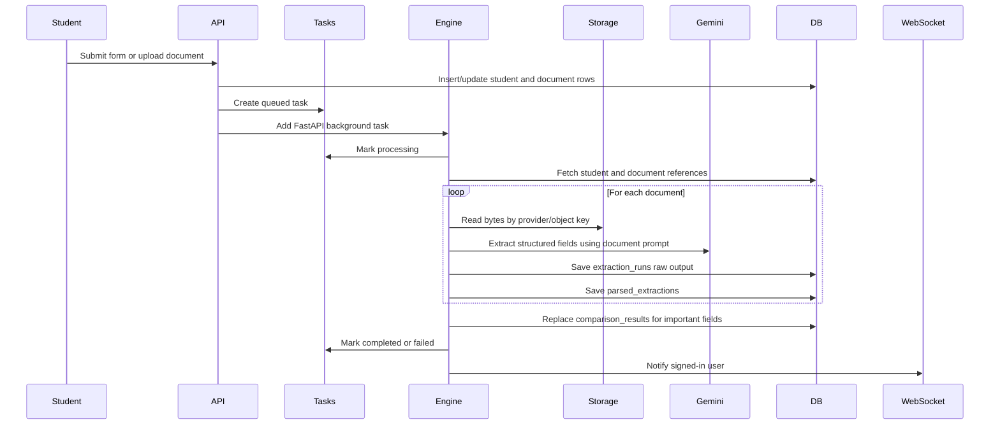

# AdmitMe Engine Low-Level Design

## Current Working Status

The engine flow is wired end to end in code:

- `backend/main.py` registers `routers.engines`, `routers.forms`, `routers.applications`, and `routers.students`.
- Student application submission and document upload queue background engine runs through `queue_engine_run`.
- Engine runs store task status, raw extraction output, parsed fields, and field-by-field comparison results.
- Runtime success still depends on configured storage providers, Google Drive availability where used, database migrations, and Gemini extraction credentials.

## Components

| Component | File | Responsibility |
| --- | --- | --- |
| Engine API router | `backend/routers/engines.py` | Starts manual engine runs, returns comparison summaries, and applies reviewer overrides. |
| Engine service | `backend/services/engine_service.py` | Fetches documents, runs extraction, parses outputs, compares extracted values with form-filled student data. |
| Extractor | `backend/extractor.py` | Converts document references to image bytes, handles PDF-to-image conversion, calls Gemini, parses JSON output. |
| Document service | `backend/services/document_service.py` | Resolves uploaded or legacy document references for a student. |
| Applications router | `backend/routers/applications.py` | Creates student application records and queues engine work after submission/upload. |
| Forms router | `backend/routers/forms.py` | Creates admin-defined forms and queues engine work after student form submission. |
| Notification service | `backend/services/notification_service.py` | Sends engine completion/failure events over the WebSocket channel. |

## Data Model

### `extraction_runs`

Stores one row per document extraction attempt.

- `student_id`: Aadhaar/student identifier.
- `document_id`: Uploaded document row when available.
- `doc_type`: Document category such as `tenth_memo`, `aadhaar`, `twelfth_memo`.
- `provider`, `object_key`: Storage reference.
- `status`: `processing`, `completed`, or `failed`.
- `raw_output`: Raw Gemini-parsed dictionary.
- `error`: Extraction error text if failed.

### `parsed_extractions`

Stores normalized fields produced from raw extraction output.

- `extraction_run_id`: Link to `extraction_runs`.
- `student_id`
- `doc_type`
- `parsed_fields`: Internal student field names and extracted values.
- `confidence`: Current implementation stores `"extracted"` per parsed field.

### `comparison_results`

Stores the verification result for important fields.

- `student_id`
- `field_name`
- `filled_value`: Value entered/submitted by the student.
- `extracted_value`: Value extracted from the uploaded document.
- `match_status`: `match`, `mismatch`, `missing_filled`, or `missing_extracted`.
- `severity`: `high`, `medium`, or `low`.
- `source_doc_type`
- `reviewer_override`, `reviewer_notes`

## Engine Flow



## Document-to-Parser Mapping

| Document Type | Prompt Source | Parsed Fields |
| --- | --- | --- |
| `tenth_memo` | `prompts[0]` | Student name, parents, DOB, tenth board, school, hall ticket, marks, percentage, identification marks. |
| `aadhaar` | `prompts[1]` | Aadhaar number and gender. |
| `jee_rank_card` | `prompts[2]` | JEE hall ticket and rank. |
| `eapcet_rank_card` | `prompts[2]` | EAPCET hall ticket and rank. |
| `transfer_certificate` | `prompts[3]` | Nationality, religion, college name, caste if present. |
| `twelfth_memo` | `prompts[4]`, or board-specific prompts `5`, `6`, `7` | Twelfth board, hall ticket, marks, percentage, month/year, subject scores. |

## Comparison Logic

1. `run_engine_for_student` loads the latest student row.
2. `_get_document_rows` resolves document references from the document table or legacy student document fields.
3. `extract_from_document_ref` loads bytes from storage and calls Gemini.
4. `parse_extraction` maps raw document-specific keys to internal student model fields.
5. `replace_comparison_results` deletes old comparison rows for that student and inserts fresh rows for `IMPORTANT_FIELDS`.
6. Values are normalized by field kind:
   - names: lowercase alphanumeric words
   - digits: numeric-only
   - numbers: first numeric value with stable formatting
   - dates: normalized to `DD/MM/YYYY` where possible
   - text: lowercase collapsed whitespace

## API Contracts

### Start Engine Run

`POST /students/{student_id}/engine-runs`

Request:

```json
{
  "doc_types": ["tenth_memo", "aadhaar"],
  "force": true
}
```

Response:

```json
{
  "task_id": "uuid",
  "student_id": "student-id",
  "status": "queued"
}
```

### Get Engine Summary

`GET /students/{student_id}/comparison-results`

Returns extraction runs, parsed extractions, and comparison results for the student.

### Reviewer Override

`PATCH /students/{student_id}/comparison-results/{field_name}`

Request:

```json
{
  "field_name": "student_name",
  "reviewer_override": true,
  "reviewer_notes": "Accepted after manual review."
}
```

## Access Control

- Admin users can run and view engine results for all students.
- Department users can access students matching their branch or degree scope.
- Student users can access only their own student record.
- Read-only users are blocked from document/status mutation endpoints, but can still view allowed records.

## Failure Handling

- Extraction failures are stored in `extraction_runs.error`.
- Background task failures update the task row to `failed`.
- WebSocket notification sends `engine_failed` to the triggering user.
- Missing documents are skipped, so a partial run can still produce comparisons for available documents.

## Verification Checklist

Use this checklist to verify the engine in a live environment:

1. Apply `003_engines_forms.sql` or `003_engines_forms_mysql.sql`.
2. Confirm storage provider startup in backend logs.
3. Submit a student form with at least Aadhaar, tenth memo, twelfth memo, and transfer certificate.
4. Confirm a task row moves from `queued` to `completed`.
5. Confirm `extraction_runs`, `parsed_extractions`, and `comparison_results` contain rows for that student.
6. Open the student details/comparison UI or call `GET /students/{student_id}/comparison-results`.
7. Test one reviewer override with the PATCH endpoint.
